# T2D-MAS — Ticket-to-Deployment Multi-Agent System

T2D-MAS shows how a team of software agents can take a user's complaint ("aplikasi nutup sendiri
pas bayar…") all the way to a monitored fix:
1. understand and mask the feedback;
2. spot duplicates;
3. judge the impact;
4. pick a squad;
5. investigate on the data nodes;
6. plan;
7. draft a change;
8. test;
9. release and watch.

People stay in control: risky or irreversible steps stop and wait for a named reviewer.

> **Course prototype** for the Agen Cerdas Enterprise group assignment (UGM). It is not a
> production platform. Where no real system exists (repository, CI, cluster, telemetry), seeded
> simulators stand in, and every output says so. [docs/AUDIT.md](docs/AUDIT.md) lists exactly
> what is real, simulated or not built, compared with the original idea.

## How a ticket moves

```mermaid
flowchart LR
    FB[User feedback<br/>reviews, e-mail, chat,<br/>crash reports] --> S1[1 Feedback capture<br/>Scout-Feedback]
    S1 --> S2[2 Triage<br/>Broker-Triage]
    S2 -- "duplicate ≥ 0.85" --> LINK[Linked to the original]
    S2 -- "0.70–0.85 or low confidence / high risk" --> H1{{Human review}}
    H1 --> S3
    S2 --> S3[Assignment<br/>Broker-Assign: Contract Net]
    S3 --> S4[3 Investigation<br/>squad worker + Scout-Log on 6 nodes]
    S4 --> S5[4 Planning<br/>Worker-Plan]
    S5 --> S6[5 Implementation<br/>Worker-Impl + secret scan]
    S6 --> S7[6 QA<br/>Worker-QA]
    S7 --> H2{{Merge review}}
    H2 --> S8[7 Deployment<br/>Worker-Deploy: 5% canary]
    S8 --> H3{{Release sign-off}}
    H3 --> S9[8 Monitoring<br/>Scout-Monitor]
    S9 -- "anomaly: new ticket" --> S1
```



The four project rules hold throughout:
1. No merge or full deploy without `human_approved`. This is checked in three places: the orchestrator, the recorded approval and the database triggers.
2. Every agent action goes into an append-only audit log.
3. Raw data never leaves a data node; only aggregates do.
4. Every number in the report can be reproduced from code with fixed seeds.

**The autonomy gate:** an agent acts on its own only if its confidence is at least **τ = 0.70** and the risk is at most **R_max = 0.60**. Otherwise a person decides.

## Run it (no Docker needed)

You need Python 3.11+ and Node 20.19+ (Vite 7 needs it). Use two terminals, both starting from the repository root.

```powershell
python -m pip install -r agents/requirements.txt
python -m uvicorn agents.app:app --port 8000
```

```powershell
cd frontend
npm install
npm run dev
```

Open the address Vite prints (usually http://localhost:5173).

**Local mode.** Without Docker the backend runs everything in one process: memory storage, an in-memory message bus and six in-process data nodes. The dashboard labels these parts as local, and everything resets when you stop the server. The dashboard's replay views also work with the backend stopped.

**Docker.** To run the full stack (orchestrator, six node containers, Redis and PostgreSQL), use `docker compose up --build`. After a database schema change, run `docker compose down -v` once.

**Live demo.** For a 5-minute presentation path, see the [live demo guide](deliverables/T2D-MAS-Live-Demo-Guide.md).

## Where things are

| Path | What it is |
|---|---|
| `agents/` | The orchestrator API and the nine agents ([README](agents/README.md), [agent catalog](agents/AGENT_CATALOG.md)) |
| `frontend/` | The React dashboard with process and monitoring animations ([README](frontend/README.md)) |
| `data/` | Database schema, ticket loaders, preprocessing, dataset statistics ([README](data/README.md)) |
| `triage/` | Offline duplicate search (MiniLM + FAISS) and severity models ([README](triage/README.md)) |
| `rca/` | Offline graph root-cause ranking (GraphSAGE, GNNExplainer, PageRank) ([README](rca/README.md)) |
| `envs/` | Offline reinforcement learning for test order and canary releases ([README](envs/README.md)) |
| `eval/` | The A0–A3 evaluation behind the report's numbers ([README](eval/README.md)) |
| `docs/` | The original idea, the final report, [the audit](docs/AUDIT.md), [report revisions](docs/REPORT_REVISIONS.md), process notes |
| `deliverables/` | Presentation deck and live demo guide |

The live agents reuse three small pieces of the offline modules:
- the autonomy gate in `triage/gate.py`;
- the GraphSAGE reference calculation in `rca/numerics.py`;
- NAPFD in `eval/metrics.py`.

The heavy models stay offline; see the module READMEs to run them.

## Evaluation (the report's numbers)

The harness compares four set-ups over the same generated tickets: 100 per seed for seeds 42–46, so 500 per set-up.
- **A0:** rule-based.
- **A1:** single agent.
- **A2:** static multi-agent.
- **A3:** multi-agent with mobile agents.

```powershell
python -m pip install -r eval/requirements.txt
python -m eval.runner --config eval/config.json --output-root results     # or: make eval
python -m eval.compare_runs results/20260930T020846305626 <new-run-folder> # same numbers as the report?
```

Results land in a timestamped folder: per-ticket and per-stage CSVs, statistical tests, security-injection results, the BAB 9.4 table and charts. Timings and memory are measurements from your machine and vary. Token counts and deployment outcomes are estimates and simulations, and are labelled as such. See [eval/README.md](eval/README.md) and the limitations in [docs/AUDIT.md](docs/AUDIT.md).

## Checks

```powershell
python -m pytest agents/tests triage/tests rca/tests envs/tests -q   # or: make test
cd frontend; npm test; npm run build
```

## Words used in the dashboard

| Term | Meaning |
|---|---|
| τ / R_max | The minimum confidence (0.70) and the maximum risk (0.60) for an agent to act alone |
| Duplicate bands | Similarity ≥ 0.85 links to the original; 0.70–0.85 asks a person; lower is a new ticket |
| Contract Net | An auction: squads bid with skill, load and cost; the best utility wins the ticket |
| Mobile agent | Code that travels to the data (the report's rule: when L > (A + R) × 3) and brings back only aggregates |
| Canary | Releasing to 5% of users first; it starts on its own only when the release risk is ≤ 0.30 |
| NAPFD | How early the test run found the failing tests (1.0 = immediately) |
| SLO | The service level a service must meet; monitoring compares against it |

## Known limitations

- **Simulated tools.** Planning, implementation, QA, deployment and monitoring use seeded simulators, not real tools. Node logs are simulated too, although the trips to the nodes, the signatures and the egress checks are real.
- **Evaluation tickets.** The evaluation tickets contain their severity word, so severity accuracy is 1.0 for every set-up. This is kept so the report's numbers stay reproducible; see the audit.
- **Lexical duplicate search.** The live duplicate search is lexical, so it misses an Indonesian and an English report of the same problem.
- **Unauthenticated reviewers.** Approvals record a reviewer name, not a logged-in identity.
- **Local-mode memory.** Active runs live in memory. Saved audit history survives a restart in Docker mode, but old runs cannot be resumed.
- **Not an isolation boundary.** Mobile bundles are signed and time-limited, but run as Python inside the node container. Do not expose the demo to untrusted networks.
